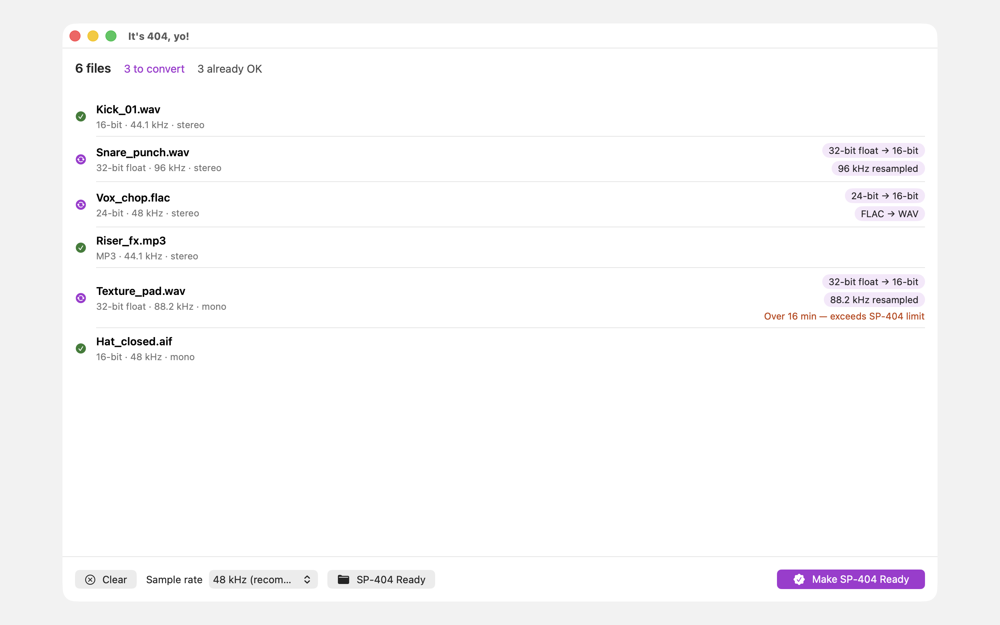

# It's 404, yo!

SP-404 sample pack converter

<!-- IAMJARL README store block for It's 404, yo! (en). Generated from apps.json, v1.34.0. Do not edit. -->
<p>
  <a href="https://apps.apple.com/app/id6785918261?pt=128512007&amp;ct=github&amp;mt=12"><picture>
    <source media="(prefers-color-scheme: dark)" srcset="https://raw.githubusercontent.com/JarlLyng/iamjarl-design/v1.34.0/badges/mac-app-store-white-en-us.svg">
    
  </picture></a>
  <br>
  $0.99 once · macOS 13 or later · <a href="https://its404yo.iamjarl.com">its404yo.iamjarl.com</a>
</p>

<p>
  <picture>
    <source media="(prefers-color-scheme: dark)" srcset="docs/screenshots/plain/appstore-02-analysis-dark.png">
    
  </picture>
</p>

It's 404, yo! batch-converts a whole sample pack into the format the Roland SP-404 MkII imports from an SD card: 16-bit linear PCM WAV at 48 kHz, or 44.1 kHz if you choose. It keeps your folder structure, copies files that already import cleanly untouched, and says in plain words what it changes in the rest, such as “32-bit float → 16-bit”, “96 kHz resampled” or “FLAC → WAV”. It is for SP-404 MkII owners whose downloaded packs come up as “Unsupported File”. It runs offline with no account, and your samples never leave your Mac.

## For developers

<p>
  <a href="https://madebyhuman.iamjarl.com"><picture>
    <source media="(prefers-color-scheme: dark)" srcset="https://madebyhuman.iamjarl.com/badges/co-created-white.svg">
    </picture></a>
  <a href="https://github.com/JarlLyng/its-404-yo/actions/workflows/ci.yml"></a>
  <a href="LICENSE"></a>
</p>

How the app behaves, why it targets the format it does, how to build it, and how it is put together.

### What it does

Drop a folder (or files) → see exactly what will change, in plain language → click
**Make SP-404 Ready** → get a converted copy that imports cleanly.

- **Analyzes** every file and tells you *why* it would fail (`32-bit float → 16-bit`,
  `96 kHz resampled`, `FLAC → WAV`).
- **Converts** to the documented safe target: **16-bit linear PCM WAV**, **48 kHz** (or 44.1),
  channels preserved, exotic metadata chunks stripped.
- **Copies** already-compatible files unchanged, no needless re-encoding.
- **Preserves** your folder structure in the output.
- **Warns** about edge cases (over 16 min / ~185 MB, or under 100 ms).
- **Optionally sanitizes** file names for SD-card import (off by default), keeping structure.

Everything runs **offline, on-device**. No network, no account, no data leaves your Mac.

### The target format (why these choices)

The SP-404 MkII processes audio internally at **16-bit linear PCM / 48 kHz** and conforms all
imports to it. Direct SD-card import accepts only **16-bit linear WAV/AIFF/MP3**; anything else
risks “Unsupported File.” See [`docs/build-spec.md`](docs/build-spec.md) for the full,
source-cited specification.

| Aspect | Rule |
| --- | --- |
| Codec | Linear PCM WAV |
| Bit depth | Force 16-bit (handles 32-bit float, 24-bit, …) |
| Sample rate | 48 kHz (default) or 44.1 kHz; resample anything else |
| Channels | Preserve mono/stereo |
| Metadata | Dropped via a clean WAV re-write |

### Requirements

- macOS 13 (Ventura) or newer
- [Xcode](https://developer.apple.com/xcode/) 16+ and [XcodeGen](https://github.com/yonaskolb/XcodeGen) to build from source

### Build from source

The Xcode project is **generated** from [`project.yml`](project.yml) (it is not committed).

```sh
brew install xcodegen      # one-time
make generate              # writes Its404Yo.xcodeproj
make open                  # open in Xcode
# or, headless:
make build
make test
```

See the [`Makefile`](Makefile) for the underlying commands.

### Architecture

A small SwiftUI app over a Core Audio conversion engine. See
[`docs/ARCHITECTURE.md`](docs/ARCHITECTURE.md).

- **UI:** SwiftUI, styled with the [IAMJARL design tokens](https://github.com/JarlLyng/iamjarl-design) Swift package.
- **Engine:** `ExtAudioFile` (AudioToolbox), decode → 16-bit PCM → WAV, with sample-rate conversion.
- **No backend, no third-party runtime dependencies** beyond the design tokens.
- **Website:** [its404yo.iamjarl.com](https://its404yo.iamjarl.com) is built from [`site/`](site) and deployed with GitHub Pages.

### Support

Email **[support@iamjarl.com](mailto:support@iamjarl.com)**, or use **Help › Send Feedback…** in the
app, which fills in your app and macOS version. The maker also reads the
[Elektronauts thread](https://www.elektronauts.com/t/its-404-yo-a-small-mac-app-that-makes-any-sample-pack-sp-404-mkii-ready/253645).
GitHub issues are welcome too. More on the [support page](https://its404yo.iamjarl.com/support.html).

### Roadmap

Live on the Mac App Store. Open work is tracked in
[**GitHub Issues**](https://github.com/JarlLyng/its-404-yo/issues), highlights:

- Splitting files over the 16 min / 185 MB limit ([#6](https://github.com/JarlLyng/its-404-yo/issues/6))
- Optional level normalization ([#18](https://github.com/JarlLyng/its-404-yo/issues/18))
- In-app text size ([#9](https://github.com/JarlLyng/its-404-yo/issues/9))
- Exploring additional device profiles ([#15](https://github.com/JarlLyng/its-404-yo/issues/15))

### Credits

- Design tokens: [iamjarl-design](https://github.com/JarlLyng/iamjarl-design)
- Co-created with AI, [madebyhuman.iamjarl.com](https://madebyhuman.iamjarl.com)
- Format research draws on Roland’s official SP-404 MkII manuals and the community converters by
  [pkMinhas](https://github.com/pkMinhas/SP404WavConvertor),
  [seb-patron](https://github.com/seb-patron/SP404mk2-wav-converter), and others.

> *Roland and SP-404 are trademarks of their respective owners. This is an independent tool and is
> not affiliated with or endorsed by Roland.*

### License

[MIT](LICENSE). It's 404, yo! is made by Jarl at [IAMJARL](https://iamjarl.com).
